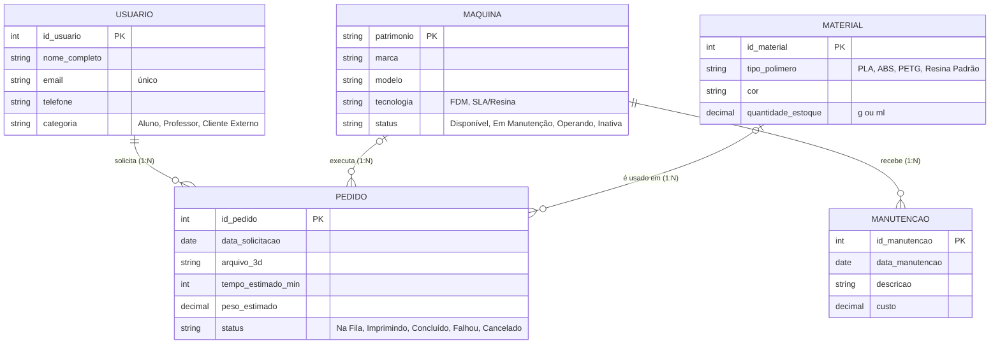

# Modelo Entidade-Relacionamento (conceitual)

O diagrama abaixo é renderizado automaticamente pelo GitHub (Mermaid).

## Cardinalidades

| Relacionamento | Cardinalidade | Explicação |
|---|---|---|
| Usuário – Pedido | 1:N | Um usuário faz vários pedidos; cada pedido é de um único usuário. |
| Máquina – Pedido | 1:N | Uma máquina executa vários pedidos ao longo do tempo; cada pedido usa uma máquina (opcional enquanto está na fila). |
| Material – Pedido | 1:N | Um material pode ser usado em vários pedidos; cada pedido usa um material (opcional enquanto está na fila). |
| Máquina – Manutenção | 1:N | Uma máquina tem várias manutenções; cada manutenção é de uma máquina. |

Não existe nenhum relacionamento N:M neste mini mundo, então não precisamos de tabela associativa.
